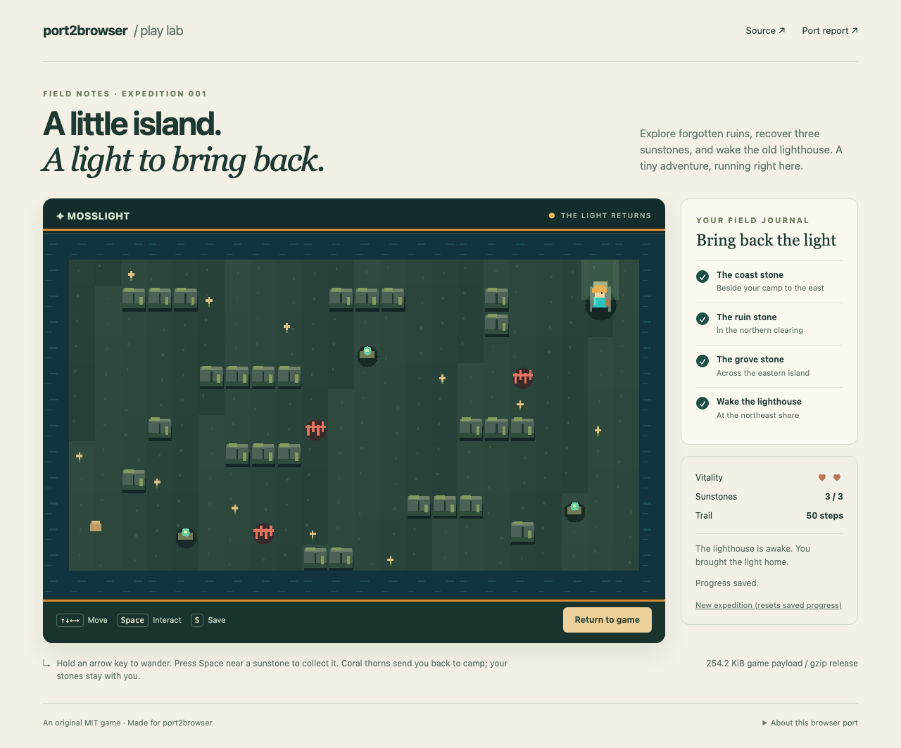

<div align="center">

<h1>port2browser</h1>

<h3>Bring offline games to the browser with your coding agent.</h3>

<p><strong><a href="https://infinuts.github.io/port2browser/">Play Mosslight — the live island adventure</a></strong> · No SDK installation needed.</p>

<p>An open-source skill for understanding game files, choosing a porting route,<br/>and building a browser version you can actually play.</p>

<p>
  <a href="https://agentskills.io/specification"></a>
  <a href="https://github.com/infinuts/port2browser/actions/workflows/check.yml"></a>
  <a href="LICENSE"></a>
  <a href="#helpers"></a>
  <a href="https://github.com/infinuts/port2browser/stargazers"></a>
</p>

<p><strong>Codex · Claude Code · Agent Skills compatible harnesses</strong></p>

<p>
  <a href="#quick-start">Quick start</a> ·
  <a href="#how-it-works">How it works</a> ·
  <a href="#what-you-can-bring">Game types</a> ·
  <a href="#helpers">Helpers</a> ·
  <a href="#faq">FAQ</a> ·
  <a href="#documentation">Documentation</a>
</p>

</div>

---

Have a game project gathering dust, or an old game that only runs on one machine?
Give your agent the files. port2browser guides it through finding the engine,
mapping the platform dependencies, and getting a small slice playable in a browser.
When the files are not enough, the result is a concrete explanation of what is missing.

The repository contains a portable routing skill, 12 task skills, engine-specific
playbooks, and three optional Python helpers. Your agent uses its own tools to do the engineering.

## What you get

A small browser game you can interact with, plus a report stating exactly what
was built, tested, and left unresolved. The original examples use generated
shapes and sound, so you can inspect and share them.



From the [Mosslight port report](examples/mosslight/port-report.md):

> Status: **playable slice** — complete original island game, tested scope below.
> Target: desktop Chromium and Firefox; native C++ and raw/compressed Wasm.

Explore, collect three sunstones, avoid thorns, and restore the lighthouse. The
live demo runs locally in your browser, with generated artwork/sound and durable
saves. [Try it](https://infinuts.github.io/port2browser/), then
[reproduce the C++ port and compressed release](examples/mosslight/README.md).
It demonstrates one original game, not automatic conversion of arbitrary files.
For an agent-produced handoff, read the [actual JavaScript pilot report](tests/evaluation-results/paired/reports/javascript-1-with_skill/PORT_REPORT.md).
It reported `build_only`; separate browser replay evidence is recorded in the
[paired pilot](tests/evaluation-results/paired/README.md).

## Quick start

Clone this repository into your agent's skill directory, keeping the folder
named `port2browser` and its supporting files together. Git is enough to install
the skill. The optional helpers require Python 3.10+ with no extra packages;
each game route has its own engine/SDK requirements.

### Codex

```sh
mkdir -p ~/.agents/skills
git clone https://github.com/infinuts/port2browser.git ~/.agents/skills/port2browser
```

Then ask:

```text
Use $port2browser on ./my-game. Identify the engine and dependencies, choose
a browser porting route, and get one level playable with keyboard and audio.
Keep the desktop build working. Target desktop Chrome and Firefox first.
```

### Claude Code

```sh
mkdir -p ~/.claude/skills
git clone https://github.com/infinuts/port2browser.git ~/.claude/skills/port2browser
```

Then ask:

```text
/port2browser Assess ./my-game for a browser port, then build and test the
smallest playable slice. Record blockers and the commands needed to run it.
```

Start a new session after installing. Other
[Agent Skills](https://agentskills.io/specification) compatible harnesses can
load the same skill directory using their own discovery instructions. See the
official [Codex](https://developers.openai.com/codex/skills/) and
[Claude Code](https://code.claude.com/docs/en/skills) documentation.

<details>
<summary><strong>Windows, project-only installs, and updates</strong></summary>

On Windows, use PowerShell. Change `.agents` to `.claude` for Claude Code:

```powershell
$skillParent = Join-Path $env:USERPROFILE '.agents\skills'
New-Item -ItemType Directory -Force -Path $skillParent | Out-Null
git clone https://github.com/infinuts/port2browser.git (Join-Path $skillParent 'port2browser')
```

For a project-only install, use `.agents/skills/port2browser` (Codex) or
`.claude/skills/port2browser` (Claude Code) inside that project. To vendor the
skill without a nested Git repository, copy `SKILL.md`, `references/`, `scripts/`,
`skills/` and `LICENSE` into that folder. Keep those paths together when updating.

Update a cloned install with `git -C /path/to/port2browser pull --ff-only`.
Pin a reviewed commit with `git -C /path/to/port2browser checkout <commit>` when
you need a repeatable setup. To uninstall, remove that skill folder from your
agent's discovery directory.

</details>

## Focused task skills and engine routes

The entrypoint loads only the instructions needed for the current task. Each
folder below has its own `SKILL.md` and license; engine notes live beside the
export, native and framework skills.

| Task folder | Responsibility |
| --- | --- |
| [recon](skills/port2browser-recon/SKILL.md) | Read-only inventory, versions, source completeness and conflicting clues |
| [route](skills/port2browser-route/SKILL.md) | Feasibility, dependency ledger and hardest-first experiments |
| [export](skills/port2browser-export/SKILL.md) | Unity, Godot, Unreal forks, Defold, Cocos, authoring tools and Ren'Py |
| [native](skills/port2browser-native/SKILL.md) | C/C++, Emscripten, rendering backends and middleware |
| [frameworks](skills/port2browser-frameworks/SKILL.md) | Rust, Java, .NET, Haxe, Lua and Python runtimes |
| [web](skills/port2browser-web/SKILL.md) | Electron/NW.js, RPG Maker and JavaScript libraries |
| [open-runtime](skills/port2browser-open-runtime/SKILL.md) | Compatible open engines and legacy emulation |
| [reverse](skills/port2browser-reverse/SKILL.md) | Bounded behavioral and format investigation |
| [platform](skills/port2browser-platform/SKILL.md) | Graphics, scheduling, input, sound, storage and network services |
| [assets](skills/port2browser-assets/SKILL.md) | Content reduction, compression, streaming and decoded-memory budgets |
| [verify](skills/port2browser-verify/SKILL.md) | Actual browser input, output, state, audio, focus and reload evidence |
| [release](skills/port2browser-release/SKILL.md) | Allowlisted packaging, hosting and accurate port reports |

The [36-route catalog](references/engine-coverage.md) documents prerequisites,
first probes and blockers. These are engineering workflows, not 36 demonstrated
ports. Modern games require their own assessment of source access, renderer,
shaders, plugins, middleware, asset memory and online services. An Unreal 4 HTML5
fork does not establish UE5 support; a desktop mod loader does not establish a
browser runtime. Preserve gameplay and disclose any proposed reduced scope.

A normal clone keeps these modules inside the `port2browser` bundle. To make
separate task skills discoverable, contributors can create a minimal collection:

```sh
# Run from this checkout; choose a new directory outside the checkout.
python3 tools/package_skills.py --layout collection --output ../port2browser-skills
# Or create one minimal bundle, without examples or development dependencies:
python3 tools/package_skills.py --layout bundle --output ../port2browser-bundle
```

Copy the generated folders into your harness's skill directory following its
own discovery instructions. Collection packaging adjusts cross-folder links;
bundle packaging retains local task modules. Neither command installs tools or
starts agents. Separately discovered task invocation has packaging checks, but
has not received a new blind agent evaluation. The recorded pilot predates this
modular workflow and does not establish its effectiveness.

## Try an original example

The examples use original MIT code, generated shapes, and generated sound.
They are optional development material; installing the skill needs none of their
toolchains or Node packages.

- [AssaultCube](examples/assaultcube/README.md): experimental C++/Wasm offline bot match using locally selected, hash-verified upstream game media. Includes browser instructions and a separate license notice.
- [Mosslight](examples/mosslight/README.md): playable C++ island adventure, raw/optimized/gzip size comparison, native and compressed browser builds.
- [SDL Beacon](examples/sdl-beacon/README.md): minimal native C and Wasm regression fixture.
- [Godot Beacon](examples/godot-beacon/README.md): native GDScript scene exported with the matching web runtime.
- [Electron Beacon](examples/electron-beacon/README.md): filesystem/IPC desktop
  services adapted to browser storage and menu handling.

For the SDL example, activate Emscripten **4.0.16**, then run from this repo:

```sh
python3 examples/sdl-beacon/build.py web
python3 scripts/serve.py examples/sdl-beacon/build/web --port 8000
```

Open `http://127.0.0.1:8000/`, click Start, press Right eight times, Space, and S.
Expect position 120, a collected beacon, and `Save ready`; reload to check the
saved state. The [completed report](examples/sdl-beacon/port-report.md) records
actual tested versions and limits. With Node.js 22+ and npm, optional automation:

```sh
npm ci
npx playwright install chromium firefox
# Build Godot with the pinned editor/templates first; see its README.
python3 examples/godot-beacon/build.py web
python3 examples/mosslight/build.py debug-web
python3 examples/mosslight/build.py web
python3 tools/build_demo.py --output examples/mosslight/build/demo
npm run test:browser
```

### Evidence, not general compatibility

| Route | Evidence level | Tested scope |
| --- | --- | --- |
| AssaultCube 1.3.0.2 C++ → Wasm/WebGL | [Tested offline slice](examples/assaultcube/port-report.md) | Chromium 141.0.7390.37 / Firefox 142.0.1; one map, three bots, movement/aim/fire, audio activation, focus and settings reload; stock media selected locally |
| C++/SDL2 → optimized/gzip Wasm | [Evaluated Mosslight adventure](examples/mosslight/port-report.md) | Chromium/Firefox versions and measured sizes in report; collision, three collectibles, hazards, completion, audio activation, focus, durable saves, corrupt-package rejection |
| SDL2/C → Emscripten 4.0.16 / SDL2 2.32.8 | [Evaluated original example](examples/sdl-beacon/port-report.md) | Chromium 141.0.7390.37 / Firefox 142.0.1 on macOS 15.7.4; one scene, input, audio activation, focus, save/reload |
| Electron 44.8.0 → browser JavaScript | [Evaluated original example](examples/electron-beacon/port-report.md) | Same browser versions/OS; gameplay plus menu and persistence; desktop filesystem/IPC smoke |
| Godot 4.5.1 standard/GDScript → single-thread web export | [Evaluated original example](examples/godot-beacon/port-report.md) | Chromium 141.0.7390.37 / Firefox 142.0.1 on macOS 15.7.4; one scene, WebGL output, input, audio activation, save/reload |
| Shipped Unity files without a project | [Blocked synthetic assessment](tests/evaluation-results/2026-10-16.md) | Missing editable project; filename clues remain inferred |
| Godot descriptor with missing native dependency | [Blocked synthetic assessment](tests/evaluation-results/2026-10-16.md) | Missing source/web extension build; config format 5 is not an engine version |
| Other engine exporters, emulation, open engines and reconstruction | Investigation only | No completed port bundled for these routes; verify the exact input/runtime |

The example checks are implementation regressions. The optional [paired agent evaluation harness](tools/evals/README.md) separately measures explicit skill invocation against the same tasks without the skill; see its [recorded pilot](tests/evaluation-results/paired/README.md). Manual
listening, mobile/Safari, long sessions, and performance profiling are untested.
Future CI runs attach their own browser versions and evidence. See the
[evaluation checklists](tests/evaluation-expected/checklists.md) and
[contribution guide](CONTRIBUTING.md).

## How it works

[![port2browser](https://readme-flow-svg.vercel.app/svg?steps=%5B%22Game+files%22%2C%22Inspect+engine%22%2C%22Choose+a+route%22%2C%22Adapt+and+build%22%2C%22Browser+playtest%22%2C%22Report+blockers%22%5D&theme=custom&traveler=code&duration=10&icons=%5B%22file%22%2C%22process%22%2C%22shield%22%2C%22build%22%2C%22test%22%2C%22message%22%5D&customTheme=%7B%22background%22%3A%22%230d1117%22%2C%22card%22%3A%22%23161b22%22%2C%22text%22%3A%22%23e6edf3%22%2C%22accent%22%3A%22%23a78bfa%22%2C%22border%22%3A%22%2330363d%22%2C%22tint%22%3A%22%23241e38%22%2C%22muted%22%3A%22%238b949e%22%2C%22line%22%3A%22%23484f58%22%7D&title=port2browser&subtitle=Inspect+the+game%2C+prove+a+viable+route%2C+and+test+a+playable+slice&layout=snake&connectionMode=custom&spacing=80&connections=%5B%7B%22from%22%3A0%2C%22to%22%3A1%2C%22label%22%3A%22%22%7D%2C%7B%22from%22%3A1%2C%22to%22%3A2%2C%22label%22%3A%22%22%7D%2C%7B%22from%22%3A2%2C%22to%22%3A3%2C%22label%22%3A%22Viable%22%7D%2C%7B%22from%22%3A3%2C%22to%22%3A4%2C%22label%22%3A%22%22%7D%2C%7B%22from%22%3A2%2C%22to%22%3A5%2C%22label%22%3A%22%22%7D%5D)](https://readme-flow-svg.vercel.app/r)

<sub>[Edit this workflow](https://readme-flow-svg.vercel.app/?steps=%5B%22Game+files%22%2C%22Inspect+engine%22%2C%22Choose+a+route%22%2C%22Adapt+and+build%22%2C%22Browser+playtest%22%2C%22Report+blockers%22%5D&theme=custom&traveler=code&duration=10&icons=%5B%22file%22%2C%22process%22%2C%22shield%22%2C%22build%22%2C%22test%22%2C%22message%22%5D&customTheme=%7B%22background%22%3A%22%230d1117%22%2C%22card%22%3A%22%23161b22%22%2C%22text%22%3A%22%23e6edf3%22%2C%22accent%22%3A%22%23a78bfa%22%2C%22border%22%3A%22%2330363d%22%2C%22tint%22%3A%22%23241e38%22%2C%22muted%22%3A%22%238b949e%22%2C%22line%22%3A%22%23484f58%22%7D&title=port2browser&subtitle=Inspect+the+game%2C+prove+a+viable+route%2C+and+test+a+playable+slice&layout=snake&connectionMode=custom&spacing=80&connections=%5B%7B%22from%22%3A0%2C%22to%22%3A1%2C%22label%22%3A%22%22%7D%2C%7B%22from%22%3A1%2C%22to%22%3A2%2C%22label%22%3A%22%22%7D%2C%7B%22from%22%3A2%2C%22to%22%3A3%2C%22label%22%3A%22Viable%22%7D%2C%7B%22from%22%3A3%2C%22to%22%3A4%2C%22label%22%3A%22%22%7D%2C%7B%22from%22%3A2%2C%22to%22%3A5%2C%22label%22%3A%22%22%7D%5D)</sub>

1. **Understand the game.** Identify the engine and version, distinguish source
   from shipped data, and trace rendering, audio, controls, saves and OS calls.
2. **Choose a route.** Compare engine exports, Emscripten/WebAssembly, browser
   runtimes, emulation and scoped reconstruction against the files available.
3. **Prove a playable slice.** Adapt the platform boundary, build one scene, and
   test its graphics, input, audio and save behavior before expanding the scope.
4. **Leave a usable handoff.** Record the changes, exact build/run commands,
   browser results, performance measurements, and anything still blocked.

The workflow keeps the native build working where source is available and
separates confirmed findings from guesses. A successful compile is recorded as
a build; playability requires browser interaction and evidence.

## What you can bring

| You have | What the agent investigates |
| --- | --- |
| An editable Unity, Godot, or other engine project | The matching web exporter, renderer settings, plugins and platform restrictions |
| C/C++ source with SDL or a portable graphics layer | An Emscripten/Wasm build and browser adaptations for the main loop, graphics, audio and files |
| A JavaScript game inside Electron or NW.js | Browser code that can stay, and Node, IPC or native services that need replacements |
| Ren'Py, LÖVE, RPG Maker or GameMaker material | The exact runtime/version, project completeness, and available web exporter or compatible runtime |
| A legacy executable, ROM or disk image | A compatible browser emulator, performance, controls, persistence and data rights |
| Game data supported by an open engine | A web-capable engine build with the original data kept under its own license |
| A proprietary binary with no source | Existing authorized ports/runtimes, bounded reverse engineering, and a feasibility decision |

These are investigation routes, not a compatibility list. Engine versions,
native extensions, unavailable services and asset formats can change the answer.
The [approach reference](references/approaches.md) explains what to check.

### No source code?

Start with an assessment:

```text
Use port2browser to inspect ./game-files without executing them. I have no
source code. Compare compatible browser emulation and open-engine options.
Keep the original assets local and explain what would block a usable port.
```

An old DOS game may have a practical emulation route. A shipped Unity build
does not supply an editable Unity project. A modern native binary may require
substantial reverse engineering and still have no workable browser route.
The skill helps the agent make that distinction early.

## Helpers

Run helpers from any working directory using the installed skill's full path.
Quote paths containing spaces. Use `python3` or `py -3` if that is your Python
launcher; the selected interpreter must be Python 3.10 or newer.

```sh
# Read-only inspection; JSON goes to stdout. Write the report outside game-files.
python /path/to/port2browser/scripts/inspect_game.py ./game-files > inspection.json
python /path/to/port2browser/scripts/inspect_game.py ./game-files --max-entries 5000

# Serve only the dedicated build output, never the whole game/repo directory.
python /path/to/port2browser/scripts/serve.py ./build-web --port 8000
# Add --isolate if the chosen runtime requires SharedArrayBuffer.
```

The inspector samples filenames, binary headers, and small dependency manifests.
It leaves archives unopened and never runs the target. Its JSON separates
inferred engine candidates from file counts, binary formats, warnings, and scan
limits. Read `truncated` and `limitations` before drawing conclusions; it is not
a decompiler, full dependency resolver, license checker, or sandbox. Keep the
input tree unchanged during inspection. Output may include private paths and
filenames, so review it before sharing.

The optional [size reporter](references/helper-reports.md) streams raw/gzip file
accounting and labels PNG/WAV decoded-memory estimates separately from measurements:

```sh
python /path/to/port2browser/scripts/size_report.py ./build-web > sizes.json
python /path/to/port2browser/scripts/serve.py ./build-web --throttle 512
```

The server supports single byte-range GETs for media seeking and a per-response
KiB/s throttle. Multipart and conditional ranges fall back to the normal response;
the throttle does not simulate latency or shared network bandwidth.

The server binds `127.0.0.1` and supports Wasm MIME types, already compressed
gzip/Brotli files, and optional COOP/COEP headers. It is a local test server;
test HTTPS and deployment configuration separately. Stop it with Ctrl+C.

## Reuse browser verification

The optional [verification helper](skills/port2browser-verify/references/verification.md)
runs a URL plus a JSON input/state plan with Playwright. It retains screenshots,
console/network errors, Web Audio evidence, element-focus checks, reload
persistence and limited navigation/frame-callback measurements. It supports
Chromium, Firefox, WebKit and compatible device profiles. Node/Playwright/pngjs
remain optional; installed Python helpers still use only the standard library.

The Electron example has touch buttons using the same gameplay actions as the
keyboard. Its new matrix checks WebKit desktop and Pixel/iPhone browser emulation,
including touch, sound, menu and reload saves. Those checks do not establish
physical-device or shipping-Safari support, nor mobile controls for the other games.
See [the scoped verification record](tests/verification/README.md).

## FAQ

<details>
<summary><strong>Does this automatically turn any executable into a web game?</strong></summary>

No. port2browser is a workflow for coding agents. Some projects have a direct
web export; others need substantial porting work, a compatible emulator, or
source that is not available. An arbitrary `.exe` cannot be passed to `emcc`
and turned into a browser build.

</details>

<details>
<summary><strong>Does it support GTA V, Skate, or other large commercial games?</strong></summary>

No commercial game ports or compatibility benchmarks are bundled here. Large
games can depend on unavailable source, desktop middleware, huge assets, or
rendering features that make a browser port impractical. Each game needs its
own feasibility assessment. A video of a game in a browser may also be remote
streaming, which is a different deliverable from running the game in the browser.

</details>

<details>
<summary><strong>Can I publish a port of a game I own?</strong></summary>

Owning a copy does not establish permission to redistribute its code or assets.
Check the game, engine, middleware and asset terms separately. A local file
import workflow can keep private assets off your hosting, but it does not settle
every rights question. See [the no-source and rights reference](references/no-source.md).
This repository contains no games, ROMs, BIOS images, or bypass tools.

</details>

<details>
<summary><strong>Do I need REA, an MCP server, or a paid tool?</strong></summary>

The skill has no required MCP server or paid service. REA is an optional aid for
authorized reverse engineering. The chosen game route may require an engine
editor, export license, SDK, emulator, or other tools; the agent should identify
those requirements before relying on them.

</details>

## Documentation

Start with [SKILL.md](SKILL.md). The agent loads the relevant reference as the
work calls for it; there is no need to load every note for every game.

| File | Use it for |
| --- | --- |
| [SKILL.md](SKILL.md) | The agent's workflow and decision boundaries |
| [Engine coverage](references/engine-coverage.md) | Version-specific route prerequisites and task playbooks |
| [Approaches](references/approaches.md) | Engine clues, export choices, Wasm, graphics and emulation |
| [Browser platform](references/browser-platform.md) | Main loop, rendering, audio, controls, storage, threads and hosting |
| [Build and test](references/build-and-test.md) | Build patterns, playtest evidence and troubleshooting |
| [Without source](references/no-source.md) | Runtime alternatives, scoped reconstruction and rights |
| [Port report](references/port-report.md) | A concise handoff template |

## Contribute

Useful contributions include a corrected engine clue, a reproducible build fix,
or a documented porting case with game/engine versions and browser evidence.
Keep proprietary files out of fixtures. Prefer focused references over another
framework or installer.

Run the helper and packaging tests with the standard library:

```sh
python -m unittest discover -s tests -v
```

GitHub Actions runs the same suite on Windows, Linux and macOS with Python 3.10 and
3.14. It checks the helper behavior, local documentation links, manifest fields,
and a minimal copied install launched from another directory.

For changes to the workflow, also use the [manual evaluation cases](tests/scenarios.md).
Automated helper tests cannot establish that an agent can port an arbitrary game.
Keep existing helper arguments and JSON fields compatible; add fields within
`schema_version: 1`, and bump that version for a breaking schema change. Commit
related changes together so regressions can be traced and reverted.

For additive inspection fields and partial-scan interpretation, see the
[JSON contract](references/inspection-json.md). For release versions and update
instructions, see the [changelog](CHANGELOG.md). Report vulnerabilities using the
[security policy](SECURITY.md). CI pins both Emscripten 4.0.16 and its emsdk
checkout in [one setup action](.github/actions/setup-emsdk/action.yml).

## License and inspiration

[MIT](LICENSE), for port2browser's own code and documentation. Game files and
external tools retain their own terms.

Inspired by [REA](https://github.com/morluto/rea)'s practice of grounding reverse
engineering findings in evidence. The task-folder and engine-playbook organization
is also inspired by [universal-modder](https://github.com/rehan-remade/universal-modder).
Both are optional references; no code, hooks, tool installs or services from
either project are bundled.

<p align="center">
  <a href="https://github.com/infinuts/port2browser/issues">Report an issue</a> ·
  <a href="https://github.com/infinuts/port2browser/pulls">Contribute a fix</a> ·
  <a href="#port2browser">Back to top</a>
</p>
